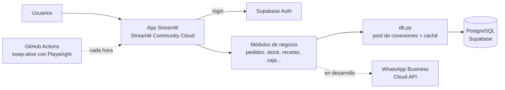

# Sistema de gestión — La PanaderIA

Aplicación de datos que uso a diario para operar mi emprendimiento de panadería: costeo de recetas, stock, pedidos, clientes, flujo de caja y KPIs. Partió como una app local sobre SQLite y hoy corre en la nube, sobre PostgreSQL (Supabase) y Streamlit Community Cloud.

**Stack:** Python · pandas · Streamlit · PostgreSQL (Supabase) · psycopg2 · Supabase Auth · GitHub Actions · Playwright

## Qué resuelve

| Módulo | Qué hace |
| --- | --- |
| Costeo | Costo real de cada pan: ingredientes con historial de precios, más luz (según el programa de la máquina), empaque y mano de obra. Avisa cuando una receta queda bajo su margen objetivo. |
| Stock | Inventario por movimientos: compras por formato, mermas y conteos. Descuenta ingredientes y bolsas al pasar un pedido a producción y avisa faltantes. |
| Pedidos | Flujo de estados (recibido → confirmado → en producción → listo → entregado). El precio de cada ítem se congela al tomar el pedido, y la capacidad diaria se mide en minutos de preparación, no en panes. El cobro genera el ingreso en caja. |
| Clientes | Ficha, historial y rankings: quién compra más y qué pan se pide más. |
| Flujo de caja | Ingresos y gastos por medio de pago y categoría, con comisiones de pagos electrónicos. |
| Dashboard | KPIs mensuales comparados con el mes anterior, incluido qué pan se vende más y cuál deja más margen. |
| WhatsApp *(en desarrollo)* | Avisos al cliente en los hitos del pedido mediante plantillas de WhatsApp Business (Cloud API de Meta), con registro de cada envío. Aún no está activo en producción. |

## Arquitectura



- **Lógica separada de la interfaz.** `app.py` solo dibuja pantallas; las reglas del negocio viven en módulos (`pedidos.py`, `stock.py`, `recetas.py`, …).
- **Pool de conexiones.** `db.py` reutiliza conexiones con `psycopg2` en vez de abrir una nueva en cada consulta: abrir una conexión TLS contra Supabase toma unos 800 ms y tomarla del pool, entre 10 y 20 ms.
- **Caché que se invalida al escribir.** Las lecturas se cachean con `st.cache_data` y toda escritura limpia esa caché, así que todos los usuarios conectados ven el dato nuevo.
- **Esquema versionado.** `inicializar_db()` crea las tablas y aplica migraciones al arrancar. `VERSION_ESQUEMA` obliga a Streamlit Cloud a correr la migración nueva después de cada despliegue.
- **Credenciales fuera del código.** La conexión a la base y Supabase Auth se configuran en `st.secrets` (`.streamlit/secrets.toml` en local, panel de Secrets en Streamlit Cloud).
- **Acceso controlado.** Login con Supabase Auth; los usuarios se crean a mano, sin auto-registro.
- **App siempre disponible.** Un workflow de GitHub Actions abre la app cada hora con Playwright para que Streamlit Cloud no la duerma.

## Modelo de datos

14 tablas en PostgreSQL:

| Grupo | Tablas |
| --- | --- |
| Costeo | `ingredientes`, `historial_precios_ingredientes`, `recetas`, `receta_ingredientes` |
| Stock y caja | `movimientos_stock`, `movimientos_caja` |
| Pedidos y clientes | `clientes`, `pedidos`, `pedido_items`, `mensajes_whatsapp` |
| Configuración | `configuracion_comisiones`, `configuracion_costos`, `configuracion_produccion`, `configuracion_cobranza` |

## Migración de SQLite a Supabase

La primera versión corría solo en un computador, con la base en un archivo SQLite. Para usarla desde varios dispositivos la migré a PostgreSQL en Supabase, por etapas:

1. **Esquema:** portado a PostgreSQL, con tipos booleanos y claves foráneas.
2. **Módulos de negocio:** adaptados uno por uno (placeholders `%s`, `RETURNING` en lugar de `lastrowid`). Un envoltorio en `db.py` mantiene el `.execute()` de sqlite3 para no reescribir cada consulta.
3. **Datos reales:** `migrar_datos.py` los copia desde SQLite sin modificar el archivo original:
   - inserta respetando el orden de las claves foráneas y convierte los 0/1 de SQLite a booleanos;
   - corre todo en una sola transacción, verifica que los conteos coincidan y, si no, hace rollback completo;
   - aborta si el destino ya tiene datos, para no duplicarlos, y reajusta las secuencias de IDs.
4. **Acceso y rendimiento:** login con Supabase Auth, pool de conexiones y caché de lecturas.

Dos lecciones del despliegue:
- Streamlit Cloud recarga el código sin reiniciar el proceso, así que una migración nueva no corría porque la inicialización seguía en caché. De ahí la clave `VERSION_ESQUEMA`.
- Con psycopg2, un `%` literal dentro del SQL de una migración rompe la consulta: hay que escaparlo (`%%`) o evitarlo.

## Cómo ejecutarlo

Requiere Python 3.10+ y un proyecto en Supabase.

1. Instala las dependencias:
   ```bash
   pip install -r requirements.txt
   ```
2. Crea `.streamlit/secrets.toml` (está en `.gitignore`, nunca se sube):
   ```toml
   [postgres]
   url = "postgresql://..."        # cadena de conexión de Supabase

   [supabase]
   url = "https://<proyecto>.supabase.co"
   anon_key = "..."

   # Opcional: avisos por WhatsApp (en desarrollo)
   [whatsapp]
   phone_number_id = "..."
   access_token = "..."
   ```
3. Levanta la app con `streamlit run app.py`, o con `iniciar_app.sh` / `iniciar_app.bat`. Al arrancar, `inicializar_db()` crea las tablas y aplica las migraciones.
4. Crea los usuarios en Supabase → Authentication → Users.

El repositorio incluye un Dev Container: en GitHub Codespaces deja las dependencias instaladas y levanta la app (igual necesita los secretos).

## Estructura del proyecto

```
├── app.py                  # Interfaz (Streamlit)
├── auth.py                 # Login con Supabase Auth
├── db.py                   # Conexión, pool, caché, esquema y migraciones
├── ingredientes.py         # Ingredientes, insumos e historial de precios
├── recetas.py              # Costeo y margen por receta
├── costos_indirectos.py    # Luz, empaque y mano de obra
├── stock.py                # Stock por movimientos
├── produccion.py           # Capacidad de producción diaria
├── pedidos.py              # Pedidos, estados y cobro
├── clientes.py             # Fichas y rankings de clientes
├── caja.py                 # Flujo de caja
├── dashboard.py            # KPIs mensuales
├── whatsapp.py             # Avisos por WhatsApp Business (en desarrollo)
├── migrar_datos.py         # Migración única de SQLite a Supabase (requiere `toml`)
├── legacy/main.py          # Primera versión: menú de consola
├── docs/manual.md          # Manual del negocio, hoja de ruta y bitácora
├── .github/                # Keep-alive (GitHub Actions + Playwright)
├── .devcontainer/          # Entorno para Codespaces
└── requirements.txt
```

`legacy/main.py`: primera versión del sistema, un menú de consola creado cuando el proyecto usaba SQLite. Comparte la capa de datos (`db.py`) con la app, pero ya no se mantiene; la interfaz actual es la app en Streamlit (`app.py`) sobre Supabase.

## Documentación

El funcionamiento detallado de cada módulo, la hoja de ruta y la bitácora de cambios están en [`docs/manual.md`](docs/manual.md).
